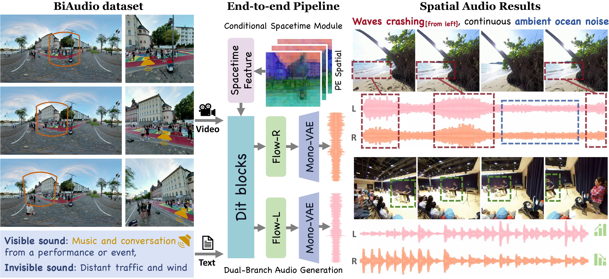

# ViSAudio: End-to-End Video-Driven Binaural Spatial Audio Generation

[Paper](https://arxiv.org/abs/2512.03036) |
[Project Page](https://kszpxxzmc.github.io/ViSAudio-project/) |
[Demo Video](https://www.youtube.com/watch?v=5kVOYc_DwQc) |

[Mengchen Zhang](https://kszpxxzmc.github.io), [Qi Chen](https://github.com/Moon0316), [Tong Wu✉️](https://wutong16.github.io), [Zihan Liu](https://github.com/LiuZH-19), [Dahua Lin✉️](http://dahua.site/)

ViSAudio generates binaural spatial audio from video and optional text prompts.
The released model produces 44.1 kHz left/right audio, with an 8-second default
duration. Text-only generation is also supported.



## Installation

Use Linux, a CUDA GPU, and Python 3.10 or newer (3.12 recommended). Run the
following commands from the repository root.

```bash
conda create -n visaudio python=3.12
conda activate visaudio
conda install "ffmpeg>=6,<7" -c conda-forge
pip install torch==2.5.1 torchvision==0.20.1 torchaudio==2.5.1 \
  --index-url https://download.pytorch.org/whl/cu124
pip install -e .
```

Video inference and feature extraction require the PE vision encoder. Use the
pinned source below rather than installing its full dependency set, which
conflicts with this project's NumPy requirements.

```bash
git clone https://github.com/facebookresearch/perception_models.git ../perception_models
export PYTHONPATH="$(realpath ../perception_models)${PYTHONPATH:+:$PYTHONPATH}"

# Check PE and the FFmpeg executables used by inference.
python -c "import core.vision_encoder.pe"
python -c "import shutil; assert shutil.which('ffmpeg') and shutil.which('ffprobe')"
```

Python inference also discovers `../perception_models` automatically. If the
source is elsewhere, set `PE_ROOT=/path/to/perception_models` before running
`demo.py` or `demo_batch.py`; this path must contain `core/vision_encoder/pe.py`.

Training on extracted features does not load the visual encoders.

To rebuild the bundled input examples from a local dataset, run
`python prepare_assets.py --source-root <path-to-data-parent>`.
The source root must contain `DATA/BiAudio` and `DATA/MUSIC`; it defaults to the
repository's parent directory. Paths in `assets/input/manifest.json` are relative
to this source root.

## Model Weights

Only the ViSAudio checkpoint needs to be provided manually: place it at
`weights/visaudio_large_44k.pth`, or specify `--model_path` for inference.
Upstream weights are downloaded when needed; the empty-text embedding is generated
during feature extraction.

| File / Component | Purpose | Preparation |
|---|---|---|
| `weights/visaudio_large_44k.pth` | ViSAudio inference model | Provide manually ([source](https://huggingface.co/Dubhe-zmc/ViSAudio/blob/main/visaudio_large_44k.pth)) |
| `weights/mmaudio_large_44k_v2.pth` | Training initialization | Auto-download ([source](https://huggingface.co/hkchengrex/MMAudio/blob/main/weights/mmaudio_large_44k_v2.pth)) |
| `ext_weights/v1-44.pth` | Audio VAE | Auto-download ([source](https://huggingface.co/hkchengrex/MMAudio/blob/main/ext_weights/v1-44.pth)) |
| `ext_weights/synchformer_state_dict.pth` | Video synchronization encoder | Auto-download ([source](https://huggingface.co/hkchengrex/MMAudio/blob/main/ext_weights/synchformer_state_dict.pth)) |
| `ext_weights/empty_string.pth` | Empty-text embedding (training only) | Auto-generated during feature extraction |

The source links are optional for manual preparation. First use requires internet
access; offline runs require the weights and caches to be prepared in advance.

## Inference

```bash
# Video only.
python demo.py --video <path-to-video> --video_only --output <output-dir>

# Video + text.
python demo.py --video <path-to-video> --prompt "<prompt>" --output <output-dir>

# Batch inference with videos and same-stem .txt captions in the input directory.
python demo_batch.py --input <input-dir> --gpus 0,1,2,3 --output <output-dir>
```

Without `--prompt`, video+text mode reads the video's same-stem `.txt` file.
Use `--output` to choose the output directory (default: `assets/output`).
Results are saved as MP4, stereo FLAC, and JSON.
Defaults: 8 seconds, 25 steps, CFG 4.5, seed 14159265.

## Dataset

[BiAudio](https://huggingface.co/datasets/Dubhe-zmc/BiAudio) contains approximately
97K perspective video clips with binaural audio and fine-grained captions.
See [dataset/dataset.md](dataset/dataset.md) for metadata and construction.

Training expects stereo audiovisual clips and TSV files with `id` and `label`
columns. Videos are named `<id>.mp4`.

```text
../DATA/
  BiAudio/
    video/{train,test}/
    caption/{train,test}_valid.tsv
  MUSIC/
    video/{train,test}/
    caption/{train,test}.tsv
```

## Training

### Extract Features

```bash
for split in train test; do
  python -m torch.distributed.run --standalone --nproc_per_node=1 \
    training/extract_video_training_latents.py --dataset BiAudio --split "$split" \
    --video_root "../DATA/BiAudio/video/$split" \
    --tsv "../DATA/BiAudio/caption/${split}_valid.tsv"
  python -m torch.distributed.run --standalone --nproc_per_node=1 \
    training/extract_video_training_latents.py --dataset MUSIC --split "$split" \
    --video_root "../DATA/MUSIC/video/$split" \
    --tsv "../DATA/MUSIC/caption/$split.tsv"
done
```

The extractor writes per-clip `.pt` features, valid-sample TSV manifests, and
training latent statistics under `training/<dataset>/feature/`.
Data paths are configured in `config/data/base.yaml`.

### Train

```bash
python -m torch.distributed.run --standalone --nproc_per_node=8 \
  train.py exp_id=visaudio
```

## Acknowledgements

Built on [MMAudio](https://github.com/hkchengrex/MMAudio),
[OmniAudio](https://github.com/liuhuadai/OmniAudio), and
[visage](https://github.com/jaeyeonkim99/visage), with components from
[Perception Models](https://github.com/facebookresearch/perception_models) and
[BigVGAN](https://github.com/NVIDIA/BigVGAN).

## License

Project code is provided under [Apache-2.0](LICENSE). Third-party components
retain their respective licenses. Datasets and pretrained models are subject
to their own terms; the code license does not grant rights to their underlying
training data. See [dataset/dataset.md](dataset/dataset.md) for dataset terms.

## Citation

```bibtex
@misc{zhang2025visaudioendtoendvideodrivenbinaural,
    title={ViSAudio: End-to-End Video-Driven Binaural Spatial Audio Generation},
    author={Mengchen Zhang and Qi Chen and Tong Wu and Zihan Liu and Dahua Lin},
    year={2025},
    eprint={2512.03036},
    archivePrefix={arXiv},
    primaryClass={cs.CV},
    url={https://arxiv.org/abs/2512.03036},
}
```
